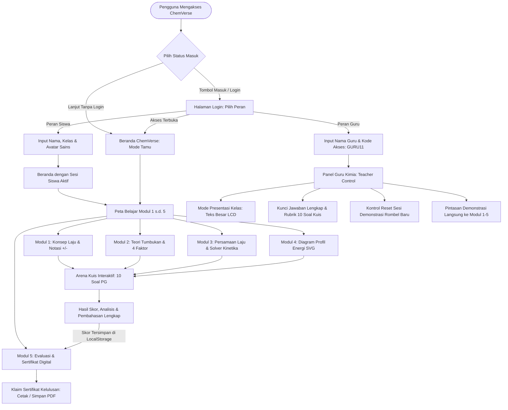

# Alur Pengguna (User Flow) — ChemVerse
**Platform Pembelajaran Kimia Digital: Laju Reaksi Interaktif Kelas 11 SMA (Fase F)**

Dokumen ini memetakan diagram alur dan langkah interaksi pengguna pada platform ChemVerse, mencakup **Alur Siswa**, **Alur Guru Kimia**, dan **Alur Tamu (Akses Terbuka Tanpa Login)**.

---

## 1. Diagram Alur Utama (Mermaid)

---

## 2. Rincian Alur Berdasarkan Peran

### 2.1. Alur Siswa (Student Flow)
1. **Akses Platform:** Siswa membuka ChemVerse di peramban (smartphone atau laptop).
2. **Masuk Akun Siswa (Opsional / Fleksibel):**
   * Mengklik tombol **🔑 Masuk / Login** di header.
   * Memilih tab **🎓 Siswa**.
   * Memasukkan nama panggilan (contoh: *Budi Santoso* / *Nafisah*), memilih kelas (*XI MIPA 1*), dan memilih avatar kimia (🧪, ⚛️, 🔬).
   * Alternatif: Tersedia tombol **"Masuk Cepat sebagai Siswa Demo"**.
3. **Eksplorasi Pembelajaran Terstruktur:**
   * **Modul 1:** Mempelajari definisi laju reaksi (\(r\)), perbedaan laju rata-rata dengan sesaat, dan hubungan koefisien bertanda \((+/-)\).
   * **Modul 2:** Mengamati visualisasi tumbukan efektif serta pengaruh 4 faktor (konsentrasi, luas permukaan, suhu, katalis).
   * **Modul 3:** Mempelajari hukum laju \(r = k[\text{A}]^m[\text{B}]^n\) dan mencoba kalkulator **Solver Orde Kinetika** interaktif.
   * **Modul 4:** Menganalisis diagram profil energi reaksi eksoterm/endoterm dengan kurva aktivasi katalis.
4. **Evaluasi Pengetahuan:**
   * Mengerjakan **Kuis Interaktif 10 Soal Pilihan Ganda**.
   * Memanfaatkan tombol petunjuk rumus (*hint*) jika menemui kesulitan.
   * Mengumpulkan jawaban dan membaca pembahasan mendalam per butir soal.
   * Skor otomatis tercatat di `localStorage` peramban.
5. **Klaim Sertifikat Kelulusan:**
   * Membuka Modul 5, nama siswa otomatis tertera pada bingkai sertifikat.
   * Siswa dapat langsung mencetak atau menyimpan dokumen dalam format PDF.

---

### 2.2. Alur Guru Kimia (Teacher Flow)
1. **Masuk Akun Guru:**
   * Mengklik tombol **🔑 Masuk / Login** lalu memilih tab **👩‍🏫 Guru Kimia**.
   * Memasukkan nama pengajar (contoh: *Ibu Rahmawati, M.Pd.*) dan kode akses pengajar (`GURU11`).
   * Alternatif: Mengklik tombol **"Masuk Cepat Mode Guru"**.
2. **Akses Panel Guru:**
   * Bilah navigasi menampilkan tombol eksklusif **👩‍🏫 Panel Guru**.
   * Di dalam Panel Guru, pengajar dapat:
     * **Mengaktifkan Mode Presentasi Kelas:** Memperbesar ukuran huruf antarmuka agar terbaca jelas saat diproyeksikan ke layar proyektor LCD di depan kelas.
     * **Melihat Kunci Jawaban Kuis Lengkap:** Memuat seluruh 10 soal pilihan ganda, opsi kunci yang benar, serta rubrik penjelasan kimia.
     * **Melakukan Pintasan Demonstrasi:** Membuka modul 1, 2, 3, 4, atau kuis secara langsung tanpa alur berputar-putar.
     * **Mereset Data Praktikum untuk Rombel Baru:** Tombol satu kali klik untuk membersihkan data progres simulasi lokal saat guru berpindah mengajar ke kelas/rombel berikutnya.

---

### 2.3. Alur Tamu (Guest / Open Access Flow)
1. **Akses Bebas Tanpa Login:**
   * Siswa atau guru dapat langsung mengklik tombol **"Mulai Belajar"** di Beranda atau tombol **"Lanjutkan Belajar sebagai Tamu"** di halaman login.
   * Seluruh materi modul 1 s.d. 5, solver kinetika, diagram profil energi, dan kuis 10 soal tetap dapat diakses penuh 100% tanpa hambatan.
   * Memastikan kepatuhan terhadap prinsip keterbukaan bahan ajar dan privasi (tanpa pengumpulan data pribadi atau biaya).

